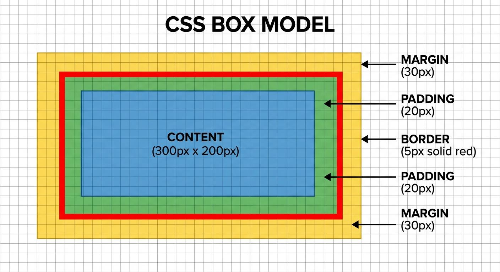

# CSS Box Model

- The CSS Box Model is an important concept in CSS.
- Every HTML element is considered as a rectangular box.
- The box model describes how the size of an element is calculated and how much space it occupies on a webpage.

## Components of the CSS Box Model



The CSS Box Model consists of four components:

### 1. Content

- The actual content inside the element, such as text, images, or other elements.
- width and height define the content size by default.

### 2. Padding

- Space between the content and the border.
- It creates internal spacing around the content.
- Background color is applied to the padding area.

### 3. Border

- A line surrounding the padding and content.
- We can set its width, style, and color.

### 4. Margin

- Space outside the border.
- It creates distance between two elements.
- Margin is transparent.

### Example:

HTML

```bash
<div class="box">
    Hello World
</div>
```

CSS

```bash
.box {
    width: 200px;
    height: 100px;
    padding: 20px;
    border: 5px solid black;
    margin: 10px;
}
```

## Calculating Total Width and Height

By default, CSS uses conent-box

### Total Width:

```
width + left-padding + right-padding + left-border + right-border + left-margin + right-margin
(200 + 20 + 20 + 5 + 5 + 10 + 10 = 270px)
```

### Total Width:

```
height + left-padding + right-padding + left-border + right-border + left-margin + right-margin
(100 + 20 + 20 + 5 + 5 + 10 + 10 = 170px)
```

## Types of Box Sizing

There are two main types:

### 1. Content-box(default)

- Width and height apply only to the content.
- Padding and border are added to the specified dimensions.

### 2. Border-box

- Width and height include content, padding, and border.
- Makes layout calculations easier.

```bash
*{
    box-sizing: border-box;
}
```

With border-box, if width is 200px, the total width including padding and border remains 200px (excluding margin).

### Difference between Padding and Margin

| Padding                                 | Margin                            |
| --------------------------------------- | --------------------------------- |
| Space inside the border                 | Space outside the border          |
| Background color applies                | Transparent                       |
| Increases the box size with content-box | Adds external spacing             |
| Used for internal spacing               | Used for spacing between elements |

### Refferences:

https://www.w3schools.com/htmlcss/htmlcss_box_model.asp  
https://www.geeksforgeeks.org/css/css-box-model/
