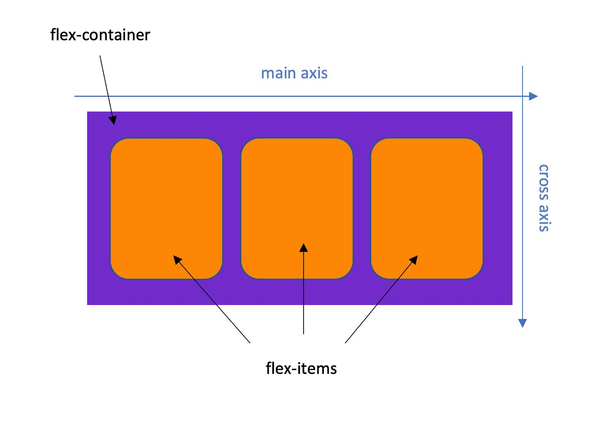

# CSS Flexbox

Flexbox stands for Flexible Box Layout.

It is a one-dimensional CSS layout system used to arrange elements in a row or a column.

It helps us align, distribute, and position elements inside a container.

## Flexbox Terminology

Flexbox has two main components:

1. Flex Container – Parent element where display: flex is applied.
2. Flex Items – Direct children of the flex container.

   

Example:  
HTML

```bash
<div class="container">
    <div class="item">A</div>
    <div class="item">B</div>
    <div class="item">C</div>
</div>
```

CSS

```bash
.container {
    display: flex;
}
```

Now the child elements are arranged horizontally by default.

## Flexbox Container Properties

### 1. display

Activates Flexbox.

```bash
.container {
    display: flex;
}
```

### 2. flex-direction

Defines the direction of flex items.

| Value          | Description             |
| -------------- | ----------------------- |
| row            | Left to right (default) |
| row-reverse    | Right to left           |
| column         | Top to bottom           |
| column-reverse | Bottom to top           |

CSS

```bash
.container {
    display: flex;
    flex-direction: row;
}
```

### 3. justify-content

Aligns items along the main axis.

| Value         | Description                          |
| ------------- | ------------------------------------ |
| flex-start    | At the beginning                     |
| flex-end      | At the end                           |
| center        | At the center                        |
| space-between | Equal space between items            |
| space-around  | Space around each item               |
| space-evenly  | Equal space between and around items |

CSS

```bash
.container {
    display: flex;
    justify-content: center;
}
```

### 4. align-items

Aligns items along the cross axis.

| Value      | Description               |
| ---------- | ------------------------- |
| stretch    | Stretches items (default) |
| flex-start | Aligns at the start       |
| flex-end   | Aligns at the end         |
| center     | Aligns at the center      |
| baseline   | Aligns text baselines     |

CSS

```bash
.container {
    display: flex;
    align-items: center;
}
```

### 5. flex-wrap

Controls whether items remain in one line or move to another line.

```bash
.container {
    display: flex;
    flex-wrap: wrap;
}
```

Values:

- nowrap – All items stay on one line (default).
- wrap – Items move to the next line when necessary.
- wrap-reverse – Wrapped lines reverse their cross-axis order.

### 6. gap

Creates space between flex items.

```bash
.container {
    display: flex;
    gap: 20px;
}
```

### 7. align-content

Controls the distribution of multiple flex lines along the cross axis when there is extra space.

It is useful when flex-wrap: wrap creates multiple lines.

## Flexbox Item Properties

### 1. flex-grow

Defines how much an item can grow compared to other items.

```bash
.item1 {
    flex-grow: 1;
}

.item2 {
    flex-grow: 2;
}
```

The second item receives twice the growth share of the first item when free space is distributed.

### 2. flex-shrink

Defines how much an item can shrink when there is insufficient space.

```bash
.item {
    flex-shrink: 1;
}
```

Default value is 1.

### 3. flex-basis

Defines the initial main size of a flex item before free space is distributed.

```bash
.item {
    flex-basis: 200px;
}
```

### 4. align-self

Overrides the align-items setting for an individual item.

```bash
.item1 {
    align-self: center;
}
```

### 5. order

Changes the visual order of flex items.

```bash
.item1 {
    order: 2;
}

.item2 {
    order: 1;
}
```

## Flex Shorthand Property

The flex property is a shorthand for:

```bash
flex: grow shrink basis;
```

Example:

```bash
.item {
    flex: 1 1 200px;
}
```

This means:

- Grow: 1
- Shrink: 1
- Basis: 200px

### Example:

HTML

```bash
<div class="container">
    <div class="box">A</div>
    <div class="box">B</div>
    <div class="box">C</div>
</div>
```

CSS

```bash
.container {
    display: flex;
    justify-content: space-around;
    align-items: center;
    gap: 20px;
    height: 300px;
    background-color: lightgray;
}

.box {
    width: 100px;
    height: 100px;
    background-color: skyblue;
    display: flex;
    justify-content: center;
    align-items: center;
}
```

# CSS Grid

CSS Grid is a two-dimensional layout system used to arrange elements into rows and columns.

Unlike Flexbox, which is primarily one-dimensional, Grid allows us to control rows and columns together.

Example:  
HTML

```bash
<div class="container">
    <div>A</div>
    <div>B</div>
    <div>C</div>
    <div>D</div>
</div>
```

CSS

```bash
.container {
    display: grid;
    grid-template-columns: 1fr 1fr;
    gap: 10px;
}
```

## Grid Properties

### 1. grid-template-columns

Defines the number and size of columns.

```bash
.container {
    display: grid;
    grid-template-columns: 1fr 1fr 1fr;
}
```

Creates three equal-width columns.

Other examples:

```
grid-template-columns: 200px 300px 200px;

grid-template-columns: 1fr 2fr 1fr;

grid-template-columns: repeat(3, 1fr);
```

### 2. grid-template-rows

Defines the height of grid rows.

```bash
.container {
   display: grid;
   grid-template-rows: 100px 200px 100px;
}
```

### 3. gap

Defines spacing between rows and columns.

```bash
.container {
   display: grid;
   gap: 20px;
}
```

You can also use:

```
row-gap: 10px;
column-gap: 20px;
```

### 4. grid-template-areas

Defines named areas for arranging elements.

HTML

```bash
<div class="container">
    <header>Header</header>
    <aside>Sidebar</aside>
    <main>Main</main>
    <footer>Footer</footer>
</div>
```

CSS

```bash
.container {
display: grid;
grid-template-columns: 1fr 3fr;
grid-template-rows: 80px 1fr 80px;

    grid-template-areas:
        "header header"
        "sidebar main"
        "footer footer";

}

header {
grid-area: header;
}

aside {
grid-area: sidebar;
}

main {
grid-area: main;
}

footer {
grid-area: footer;
}
```

### 5. grid-column

Controls how many columns an item occupies or which grid lines it spans.

```bash
.item {
   grid-column: 1 / 3;
}
```

This item starts at column line 1 and ends at column line 3, spanning two column tracks.

### 6. grid-row

Controls the rows an item occupies.

```bash
.item {
grid-row: 1 / 3;
}
```

### 7. repeat()

Repeats a column or row pattern.

```bash
.container {
   grid-template-columns: repeat(4, 1fr);
}
```

Creates four equal-width columns.

### 8. minmax()

Defines minimum and maximum sizes for grid tracks.

```bash
.container {
grid-template-columns: repeat(3, minmax(150px, 1fr));
}
```

Each column has a minimum size of 150px and can grow to share available space.

### 9. auto-fit and auto-fill

These help create responsive grid layouts.

```bash
.container {
display: grid;
grid-template-columns: repeat(
auto-fit,
minmax(200px, 1fr)
);
gap: 20px;
}
```

- auto-fit: Fits available items and collapses unused tracks.
- auto-fill: Creates as many tracks as can fit, preserving empty tracks.

### Difference Between Flexbox and Grid

| Flexbox                           | Grid                                 |
| --------------------------------- | ------------------------------------ |
| One-dimensional layout            | Two-dimensional layout               |
| Row or column                     | Rows and columns                     |
| Best for navigation and alignment | Best for page layouts and dashboards |
| Content-oriented                  | Layout-oriented                      |
| Uses display: flex                | Uses display: grid                   |

### Refference

https://www.w3schools.com/htmlcss/
