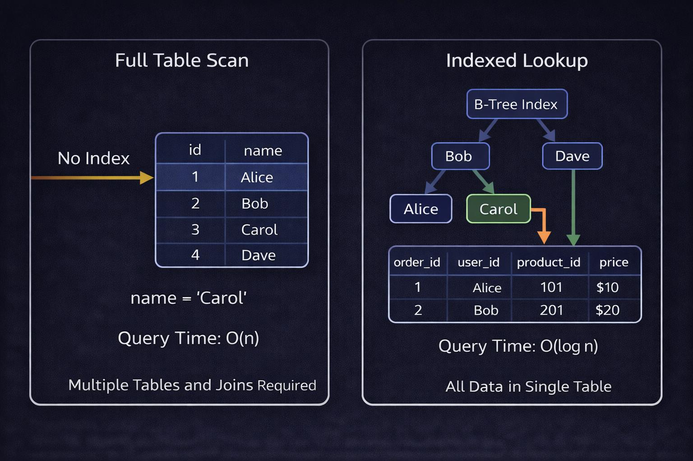

# Indexes
- An index is a database object used to speed up data retrieval from a table.
- It works similarly to the index of a book.
- Without an index, the database may scan the entire table to find a record.
- With an index, it can locate records more efficiently.



**Example:**
```bash
SELECT * FROM Employees
WHERE emp_id = 3;
```
If emp_id has an index, the database can find the employee more efficiently.

**Creating an Index**
```bash
CREATE INDEX idx_employee_name
ON Employees(name);
```
This creates an index on the 'name' column.

## Types of Indexes
### 1. Clustered Index
A clustered index determines how table data is physically organized according to the index key.
- Table data is organized around the clustered key.
- Generally, a table can have only one clustered index.
- Often associated with the primary key in SQL Server.
**Important:** MySQL InnoDB organizes table data using the primary key as its clustered index.

### 2. Non-Clustered Index
A non-clustered index is a separate structure that stores indexed values and references to the corresponding rows.
- Multiple non-clustered indexes can exist.
- It helps search data without scanning the entire table.

### 3. Unique Index
Ensures that indexed values are unique.
```bash
CREATE UNIQUE INDEX idx_unique_email
ON Users(email);
```
Duplicate non-NULL email values are not allowed.

### 4. Composite Index
An index created on multiple columns.
```bash
CREATE INDEX idx_dept_salary
ON Employees(dept_id, salary);
```
Useful for queries such as:
```bash
SELECT * FROM Employees
WHERE dept_id = 10
AND salary > 40000;
```

### 5. Full-Text Index
- Used for searching text content efficiently.
- Useful for searching words in descriptions, articles, or documents.

### Advantages of Indexes
- Faster SELECT queries.
- Faster searching and filtering.
- Can improve JOIN performance.
- Can improve ORDER BY performance.
- Unique indexes enforce uniqueness.

### Disadvantages of Indexes
- Consume additional storage.
- INSERT, UPDATE, and DELETE may become slower.
- Too many indexes increase maintenance overhead.
- Indexes need to be maintained when data changes.


**Creating indexes on columns frequently used in:**
- WHERE conditions
- JOIN conditions
- ORDER BY
- Certain GROUP BY operations

**Note**:Indexes can improve read operations but may slow down write operations because the index must also be maintained.
