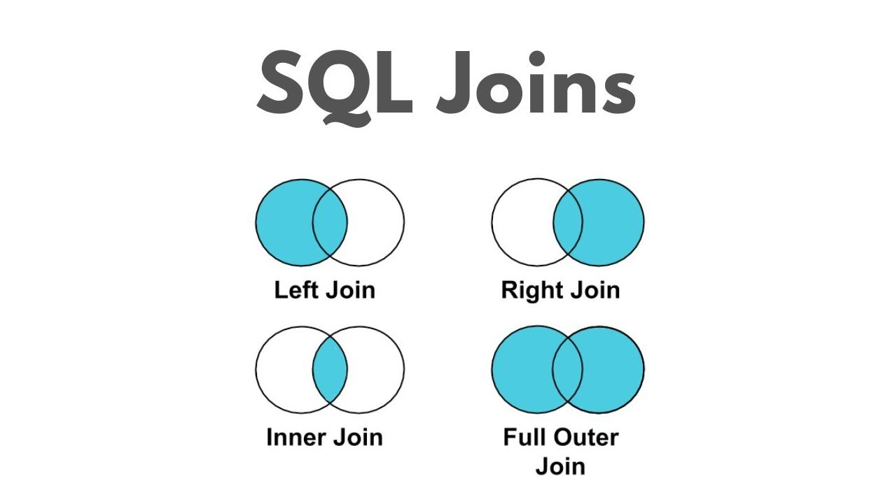

# SQL JOINS
## JOIN 
In SQL joins are used to combine rows from two or more tables based on a related column.  

Example:  
Employees table contains department IDs, and Departments table contains department names.  
We can join them to get employee names with department names.

## Types Of JOINs


Table1 name: Employees
|emp_id|name|dept_id|salary|
|------|------|-------|------|
|1|Rahul|10|50000|
|2|Priya|20|60000|
|3|Amit|10|45000|
|4|Neha|NULL|40000|

Table2 name: Departments

|dept_id|dept_name|
|--------|---------|
|10|IT|
|20|HR|
|30|Finance|

### 1. INNER JOIN
Returns only matching rows from both tables.    
```bash
SELECT e.name, d.dept_name
FROM Employees e
INNER JOIN Departments d
ON e.dept_id = d.dept_id;
```
Output:
|name|dept_name|
|------|-------|
|Rahul|IT|
|Priya|HR|
|Amit|IT|

Neha is excluded because her department ID is NULL.

### 2. LEFT JOIN
Returns:
- All rows from the left table.
- Matching rows from the right table.
- NULL when no matching row exists.
```bash
SELECT e.name, d.dept_name
FROM Employees e
LEFT JOIN Departments d
ON e.dept_id = d.dept_id;
```
Output:
|name|dept_name|
|-----|--------|
|Rahul|IT|
|Priya|HR|
|Amit|IT|
|Neha|NULL|

### 3. RIGHT JOIN
Returns:
- All rows from the right table.
- Matching rows from the left table.
- NULL when no matching row exists.
```bash
SELECT e.name, d.dept_name
FROM Employees e
RIGHT JOIN Departments d
ON e.dept_id = d.dept_id;
```
Output:
|name	|dept_name|
|-----|-------|
|Rahul|	IT|
|Amit|	IT|
|Priya|	HR|
|NULL|	Finance|

Finance is included even though no employee belongs to it.

### 4. FULL OUTER JOIN
Returns all matching and non-matching rows from both tables.
```bash
SELECT e.name, d.dept_name
FROM Employees e
FULL OUTER JOIN Departments d
ON e.dept_id = d.dept_id;
```
Output:
|name|dept_name|
|-----|-------|
|Rahul|IT|
|Priya|HR|
|Amit|IT|
|Neha|NULL|
|NULL|Finance|

**Note** : MySQL does not directly support FULL OUTER JOIN. It can be simulated using LEFT JOIN and RIGHT JOIN with UNION.

### 5. CROSS JOIN
Returns the Cartesian product of both tables.  
Every row from the first table is combined with every row from the second table.  
If Employees has 4 rows and Departments has 3 rows:  
Result = 4 × 3 = 12 rows.
```bash
SELECT e.name, d.dept_name
FROM Employees e
CROSS JOIN Departments d;
```
Output:
|name|	dept_name|
|-----|-------|
|Rahul|	IT|
|Rahul|	HR|
|Rahul|	Finance|
|Priya|	IT|
|Priya|	HR|
|Priya|	Finance|
|Amit|	IT|
|Amit|	HR|
|Amit|	Finance|
|Neha|	IT|
|Neha| HR|
|Neha|	Finance|

### 6. SELF JOIN
A table is joined with itself.  
Example: Employee and manager relationship.  
Table name: Employees
|emp_id	|name	|manager_id|
|------|------|--------|
|1	|Rahul|	NULL|
|2	|Priya|	1|
|3	|Amit	|1|
|4	|Neha|	2|
|5	|Kiran|	2|
```bash
SELECT e.name AS employee,
       m.name AS manager
FROM Employees e
LEFT JOIN Employees m
ON e.manager_id = m.emp_id;
```
Output:
|Employee|	Manager|
|------|------|
|Rahul|	NULL|
|Priya|	Rahul|
|Amit	| Rahul|
|Neha|	Priya|
|Kiran|	Priya|

### JOIN summary
|JOIN|	Result|
|----|------|
|INNER|	Matching rows only|
|LEFT	|All left + matching right|
|RIGHT|	All right + matching left|
|FULL|	All rows from both|
|CROSS|	Cartesian product|
|SELF|	Table joined with itself|
