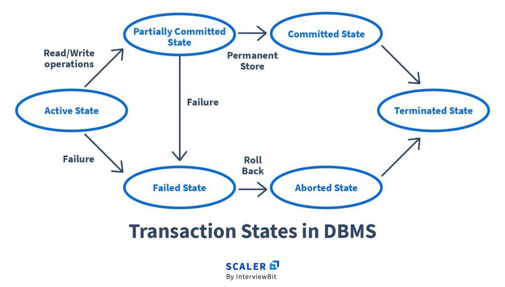

# Transactions
A transaction is a group of database operations treated as one logical unit of work.  
A transaction either completes successfully or is rolled back.  

**Example**:
- Transfer money.
- Place an order.
- Book a ticket.
- Update employee records.

## Transaction Commands - TCL
TCL stands for Transaction Control Language. 

**Important commands**:
|Command	|Meaning|
|-----|-----|
|COMMIT	|Permanently saves changes|
|ROLLBACK	|Undoes uncommitted changes|
|SAVEPOINT	|Creates a point within a transaction|
|ROLLBACK TO SAVEPOINT|	Rolls back to a specific point|

### Example: Commit
```bash
START TRANSACTION;

UPDATE Employees
SET salary = salary + 5000
WHERE emp_id = 1;

UPDATE Employees
SET salary = salary + 5000
WHERE emp_id = 2;

COMMIT;
```
Both updates are committed.

### Example: Rollback
```bash
START TRANSACTION;

UPDATE Employees
SET salary = 100000
WHERE emp_id = 1;

ROLLBACK;
```
The salary change is undone, assuming it was not committed.

### Example: Savepoint
```bash
START TRANSACTION;

UPDATE Employees
SET salary = salary + 1000
WHERE emp_id = 1;

SAVEPOINT s1;

UPDATE Employees
SET salary = salary + 2000
WHERE emp_id = 2;

ROLLBACK TO s1;

COMMIT;
```
The first update remains, while the second update is undone.

### Transaction States


|State|	Meaning|
|-----|------|
|Active	|Transaction is executing|
|Partially committed|	Final operation executed, commit processing not yet fully completed|
|Committed|	Transaction successfully completed|
|Failed	|Transaction cannot continue|
|Aborted	|Transaction changes are rolled back|
|Terminated|Transaction executed|
